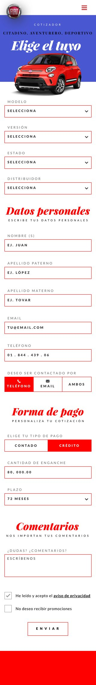
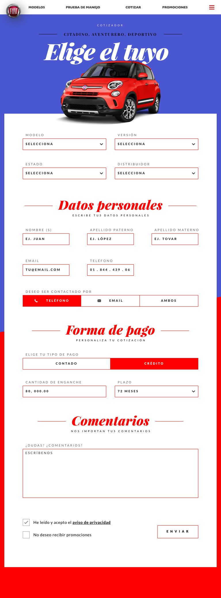
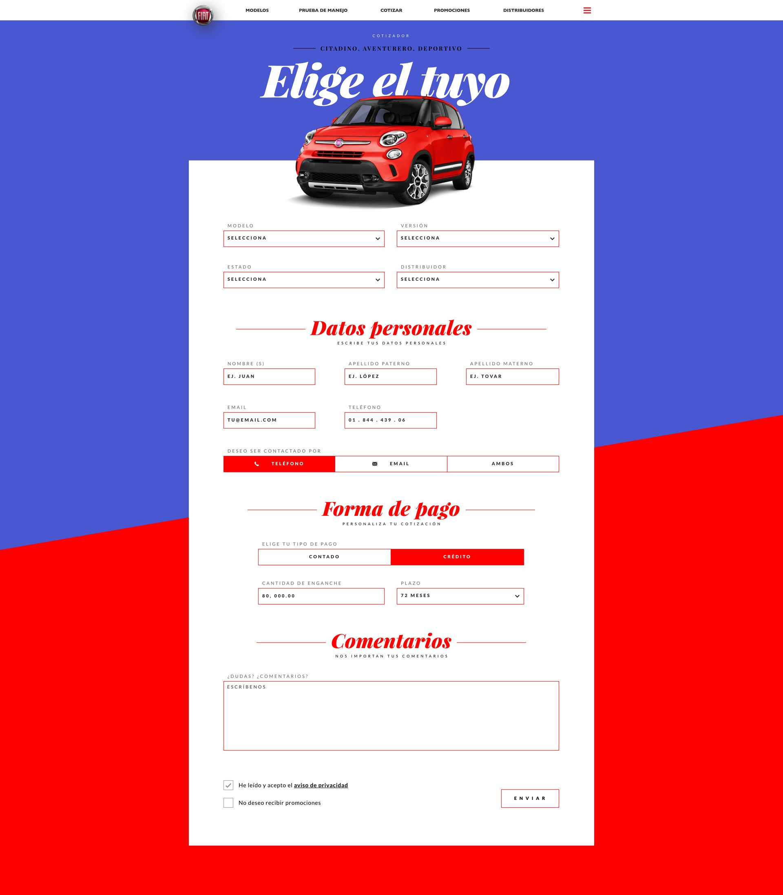
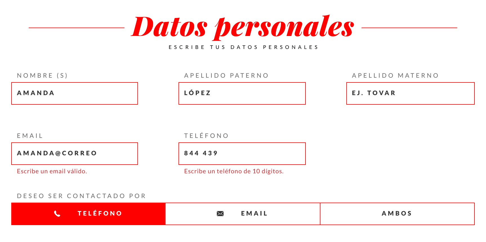
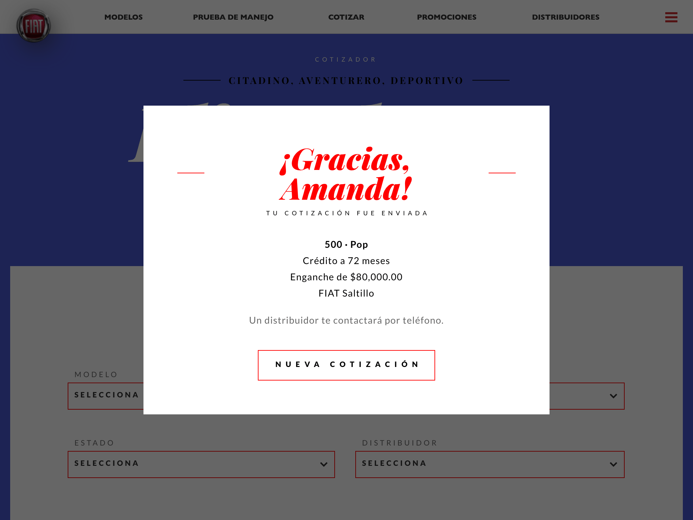
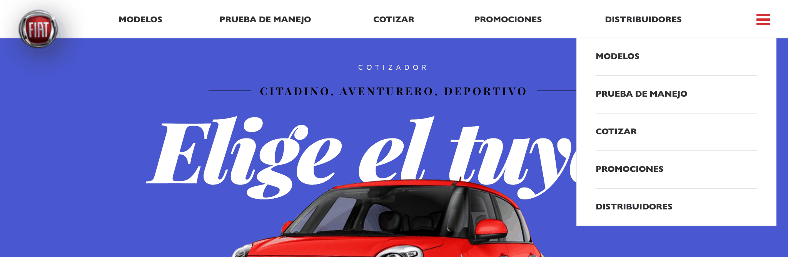

# FIAT Quote Form

HTML rendition of the FIAT _Cotizador_ PSD at its three designed sizes (320, 768 and 1024), built with Next.js, React, Tailwind CSS and TypeScript. The form validates on the client and on the server and shows a confirmation after a successful submission. As an additional learning exercise, Sanity manages the copy and dummy data.

## Getting started

Requires Node.js 20.9 or later.

```bash
npm install
cp .env.example .env.local
npm run dev
```

Then open [http://localhost:3000](http://localhost:3000). The `.env.local` step connects the page to Sanity; without it, the page renders the same content from local files.

Other scripts:

```bash
npm run build && npm start
npm run lint
```

## Stack

| Tool                      | Purpose                                           |
| ------------------------- | ------------------------------------------------- |
| **Next.js 16 + React 19** | App Router, Server Components and Server Actions. |
| **Tailwind CSS 4**        | Responsive layouts and custom design tokens.      |
| **TypeScript**            | Typed content, props and form values.             |
| **Zod 4**                 | Shared client and server validation.              |
| **Sanity**                | Headless CMS for the copy and dummy data.         |

## How the requirements are met

| Requirement                | Where                                                                                                                           |
| -------------------------- | ------------------------------------------------------------------------------------------------------------------------------- |
| Use the provided assets    | Car, logo and icons from the PSD. See [Pixel-perfect approach](#pixel-perfect-approach).                                        |
| Three screen sizes         | Mobile-first at 320, `md` at 768 and `lg` at 1024, which match Tailwind's default breakpoints. Fluid between them.              |
| Dummy data in the controls | Models, versions, the 32 Mexican states, dealers and terms in [`src/features/quote/content.ts`](src/features/quote/content.ts). |
| Specified web fonts        | Lato and Playfair Display through `next/font`. See [Pixel-perfect approach](#pixel-perfect-approach).                           |
| Pixel-perfect CSS          | Measured against the PSD at every breakpoint. See [Pixel-perfect approach](#pixel-perfect-approach).                            |
| Separation and modularity  | Feature folders, reusable UI primitives and content kept out of components. See [Project structure](#project-structure).        |

## Project structure

```
src/
├── app/                     Page, layout and global styles
├── features/
│   └── quote/               Quote feature
│       ├── components/      Sections and interaction
│       ├── actions.ts       Server validation
│       ├── schema.ts        Shared Zod schema
│       ├── confirmation.ts  Quote summary
│       ├── content.ts       Getter and local content
│       ├── sanity.ts        Sanity document mapping
│       └── types.ts         Content types
├── components/
│   ├── ui/                  Reusable controls
│   ├── layout/              Header, menu and background
│   └── icons/               SVG components
├── content/                 Site-wide copy
├── lib/                     Shared helpers
├── styles/                  Font loading
└── assets/images/           PSD images
studio/                      Sanity Studio, schemas and seed script
```

Dependencies point one way: `app → features → components, content, lib`. Shared code never imports from a feature, so a second feature could be added next to `quote/` without touching it.

## Pixel-perfect approach

- **Tokens from the PSD.** `globals.css` replaces Tailwind's default colors, font sizes, letter spacing and fonts with the design's values, named after their PSD size or role (`text-44`, `tracking-caps`).
- **1 spacing unit = 1px.** `--spacing` is `0.0625rem`, so `h-40` or `w-290` read like the PSD measurements, with no arbitrary values, and still scale with the browser's font size.
- **Measured, not eyeballed.** Sizes come from each shape's vector path, not its bounding box, which includes effects and is 2–4px too large. Every breakpoint was checked with an overlay of the PSD: boxes, columns and text sit within 1px. Uneven spacing in the PSD is kept as designed.
- **Optical compensation.** Photoshop's anti-aliasing snaps the 12px Lato capitals to 8px, so those labels use 11px with wider tracking to match.
- **PSD over JPG.** The 1024 JPG is newer and differs from the PSD (the red diagonal sits 220px higher). The layout follows the PSD, as the brief asks.
- **Fonts.** Lato loads through `next/font`, self-hosted, without render blocking or layout shift. Playfair Display uses the original 2016 v1 files (OFL) through `next/font/local`: Google Fonts replaced them in 2019 with a redesign whose `g`, `j` and accented capitals no longer match the PSD.
  The navigation uses system Gill Sans when available, with Lato as a fallback, since Gill Sans Display MT Pro was not included in the provided assets.
- **Hero title scale.** The PSD scales the "Elige el tuyo" layer to 96% of its height, so the title uses `scale-y-96` and its exact sizes (43.76, 81.27 and 114.61px) as tokens.
- **Assets.** The car is recomposed from its PSD layers, color adjustments included, and served through `next/image`. Icons are inline SVG components that use `currentColor`, so CSS controls their color.

## Technical decisions

### Server Components by default

Static composition uses Server Components. Client Components handle form state, field errors, submission feedback and menu interaction.

### Form

- **Validation and submission.** [`schema.ts`](src/features/quote/schema.ts) validates in the browser and again in [`submitQuote`](src/features/quote/actions.ts). `useActionState` manages the response; only validated data builds the confirmation.
- **Normalization.** Names and Mexican phone numbers are normalized, emails are lowercased and down payments become integer cents.
- **Inline errors.** Messages use `aria-describedby` and `aria-invalid`, appearing after the first submit and updating as fields are corrected.
- **Feedback.** The button shows a pending state. Success resets the form and opens a native `<dialog>` with the summary; "Nueva cotización" returns focus to the first field. Defaults match the design: phone contact, credit, 72 months and privacy consent checked.

### Content layer

Copy and dummy data live in Sanity as two singleton documents, `site` and `quoteForm`, edited in the Studio. Async getters fetch them on the server and the page passes them to components through props, so components don't depend on the content source. Dynamic messages use `{placeholder}` templates.

- **Caching.** Each getter uses `'use cache'` with `cacheLife('minutes')`. The page stays static and regenerates in the background on the first request after a minute, so published changes appear without a redeploy, though not instantly.
- **Fallback.** Without `SANITY_PROJECT_ID`, or if a request fails, the getters return the local content in `src/content/` and `src/features/quote/content.ts`. The same content seeds the dataset.
- **Client.** The app queries Sanity with `@sanity/client` directly. `next-sanity` adds live preview and visual editing, which this integration doesn't need, and requires the whole Studio as a peer dependency.
- **Studio.** Schemas and the seed script live in `studio/`, a separate Sanity project. Editing requires an invitation.

### Accessibility

- Semantic labels and groups, native radio inputs and checkboxes, and visible keyboard focus.
- Inline errors linked to their fields; failed submissions focus the first invalid field and announce an error summary.
- The confirmation modal uses native `<dialog>` for focus management and Escape dismissal. The navigation menu uses the Popover API for native opening, closing and light dismiss.
- `lang="es-MX"` identifies the page language for assistive technologies.

### Inconsistencies in the PSD

The three PSDs don't always agree. Where they differ:

- **Eyebrow text and placeholders:** two of the three designs agree, so those are used.
- **Typo:** "Elije tu tipo de pago" is corrected to "Elige".
- **Section title lines:** their length changes per section, so one length per breakpoint is used.
- **Off-center elements:** "Elige el tuyo" and the car are a few pixels off-center in the PSD. This is reproduced, so the page matches the overlay.

## Browser testing

Tested in Chrome, Firefox and Safari at 320, 768, 1024 and 1920px, plus intermediate widths, for both layout and form behavior.

## Known limitations

- **No persistence.** Quotes are validated on the server and confirmed, but not stored, emailed or sent to a dealership.
- **Format checks only.** Validation can't confirm that an email address or phone number exists.
- **PSD placeholders don't validate.** `01 . 844 . 439 . 06` and `80, 000.00` are kept as designed, but they aren't valid input.
- **Dummy options.** Models, versions, dealers and terms are sample data and don't depend on each other.
- **Navigation font.** Without Gill Sans installed (Windows, Android), the navigation renders in Lato.

## Screenshots

### Design

| Mobile (320)                                                     | Tablet (768)                                                     | Desktop (1920)                                                     |
| ---------------------------------------------------------------- | ---------------------------------------------------------------- | ------------------------------------------------------------------ |
|  |  |  |

### Added beyond the PSD

Inline validation errors, shown after the first submit:



Confirmation dialog after a successful submission:



Navigation menu opened from the hamburger button:


